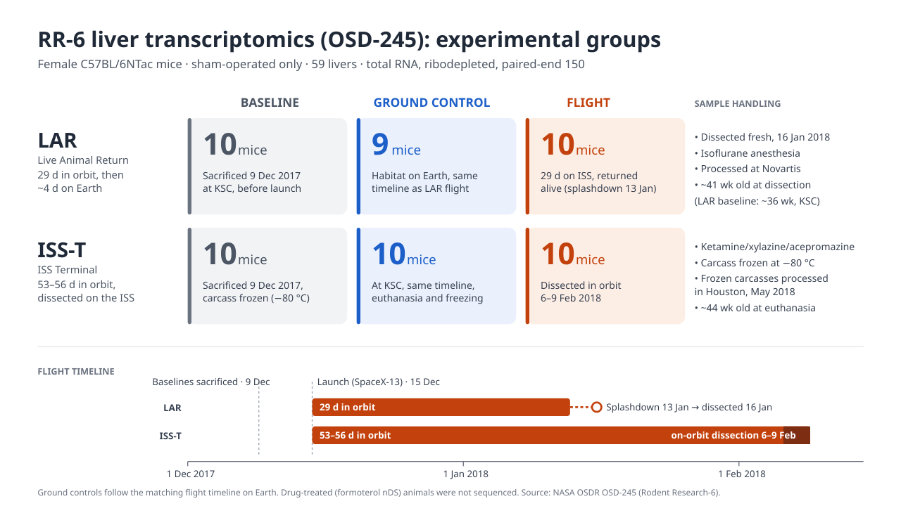
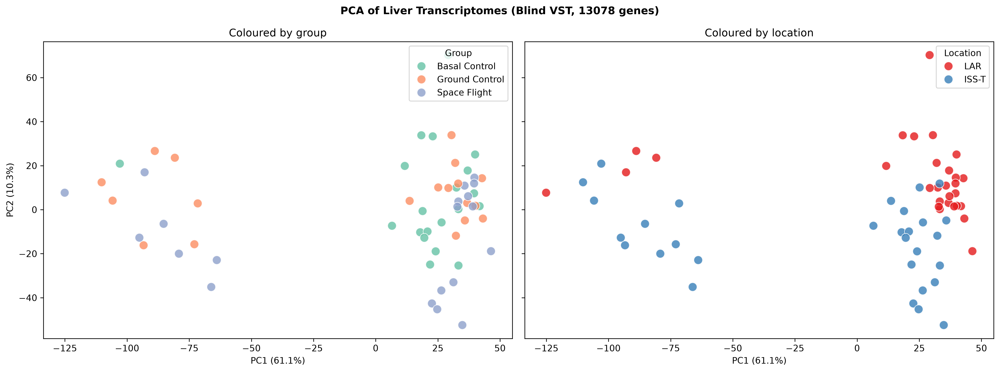
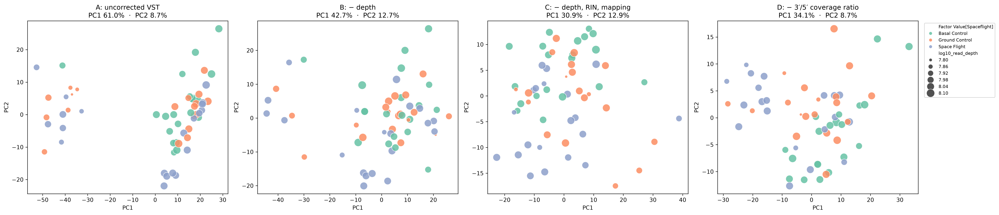
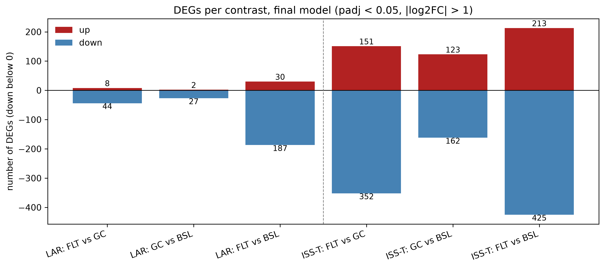
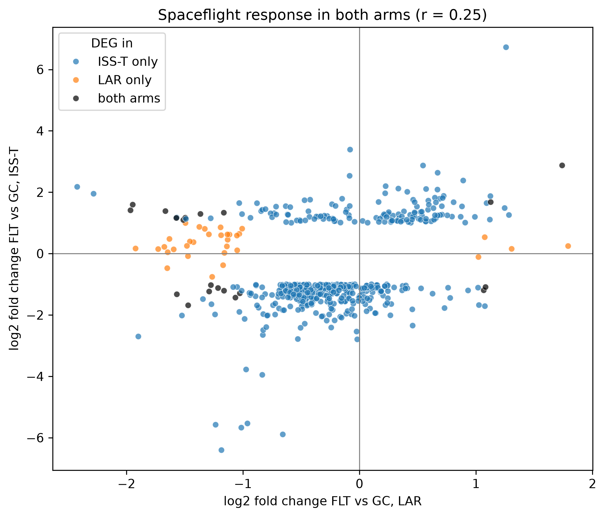

# Spaceflight effects on the mouse liver transcriptome (NASA OSD-245)

> Scientific Programming (MSB1014) course project, MSc Systems Biology & Bioinformatics, Maastricht University
>
> Author: Noah van Rossum
>
> Date: 18 October 2026

### Summary

This project aimed to identify spaceflight-perturbed protein modules in mouse liver and to determine whether these persist after return to Earth. The project was part of Scientific Programming (MSB1014). The chosen dataset for this project was a bulk RNA-seq of 59 mouse livers from NASA's Rodent Research-6 mission (OSD-245). It was found that the largest source of variation in the data was not biological but technical; a batch of 15 samples with a strong RNA-degradation signature, most likely caused by differences in sample handling. After identifying and correcting for this batch, spaceflight, mission arm and their interaction all had significant effects on liver gene expression (ASCA+, permutation p < 0.001). Following DGEA, Spaceflight changed 503 genes in mice dissected on orbit (ISS-T) but only 52 in mice returned alive to Earth (LAR). Only 20 genes responded in both experimental setups, with half of them being related to mainly genes of lipid and cholesterol synthesis. These changed in opposite directions, suggesting that part of the spaceflight response reverses after return to Earth; a form of active re-adaptation, as opposed to recovery.

## Background Information

The recent resurgence of interest in space exploration, underlined by NASA’s commitment of
the moon missions as well as its planned missions to Mars, necessitates an increase in research
towards astronauts’ health in long-duration space missions. Astronauts that returned from the
International Space Station (ISS), have previously showcased health issues related to geriatric
issues, immune dysfunction, and cardiovascular health, in addition to the well-known cancer
risk from continuous exposure of low doses of radiation [1, 2]. Pathway analyses of multi-omics
datasets from both human astronauts and rodents (NASA’s GeneLab) revealed significant enrich-
ment for mitochondrial processes, innate immunity, chronic inflammation, cell cycle, circadian
rhythm, and olfactory functions [3]. Furthermore, the study showcased the importance of organ
tissue complexity; specifically the liver. The liver undergoes more differential gene and protein
expression changes than other organs, consistent with the role of the liver as a dynamic and
critical hub in sensing changes in blood composition and maintaining homeostasis. Spaceflight
induced changes in the liver have been linked to a number of key processes, including oxidative
phosphorylation [4], lipid metabolism [5], and fibrosis linked gene expression fluxes [6].
As these processes involve many interacting proteins, spaceflight induced changes are likely
to appear as groups of functionally connected genes whose products interact (modules of
interacting proteins), rather than as isolated genes.

## Core Research question
The research question raised in this research
project can thus be phrased as follows:

**How does spaceflight change gene expression in the mouse liver, and does that response persist after return to Earth?**

1. How much of the variation is technical (sequencing depth, RNA quality) rather than biological, and how can it be corrected without removing the biological signal?
2. Which genes and pathways respond to spaceflight in mice dissected on orbit (ISS-T) and in mice returned alive to Earth (LAR)?
3. Is the spaceflight response shared between the two mission arms, or does it reverse after return?


## Dataset

- **Source:** NASA Open Science Data Repository, study [OSD-245](https://osdr.nasa.gov/bio/repo/data/studies/OSD-245) (Rodent Research-6, liver of female C57BL/6NTac mice)
- **Accessed:** 18 Oct 2026
- **Data used:** RSEM unnormalized gene counts, sample metadata, assay metadata and per-sample QC metrics, as published by NASA GeneLab
- **Design:** 59 livers; Baseline, Ground Control and Flight groups in two mission arms (10 mice per group, Ground Control LAR 9):
  - **LAR** (Live Animal Return): 29 days in orbit, ~4 days back on Earth, dissected fresh
  - **ISS-T** (ISS Terminal): 53–56 days in orbit, dissected on orbit, carcasses frozen and processed later



## Analysis pipeline

```
raw counts + metadata + QC
        │
        ▼
1. Data loading        integrity checks on counts, metadata and QC
2. Exploration         library sizes, exploratory PCA, hierarchical clustering
3. Filtering           CPM > 1 in ≥ 9 samples  →  13,078 of 57,278 genes kept
4. Normalization       median-of-ratios (own implementation), blind VST
5. Technical variation PCA vs QC metrics, PC1 loadings, R² with 82 QC metrics
                       →  PC1 split is a technical batch (RNA degradation)
6. Batch correction    group-protected covariate removal, four versions compared
7. ASCA+               variance per factor, Freedman–Lane permutation tests,
                       residual analysis → final technical covariates
8. DESeq2 (PyDESeq2)   ~ depth + RIN + 3′/5′ ratio + Group, contrasts per mission arm;
                       sensitivity models, robustness without the batch samples
9. Networks            export to STRING / Cytoscape, KEGG and WikiPathways enrichment
```

## Main results

**1. The main structure in the data is a technical batch.** A group of 15 samples separates along PC1, explained by technical variation, not biological (spaceflight effect).



**2. Correcting for the RIN, Read Depth, and 3′/5′ coverage ratio removes the batch and strengthens the biological signal.**



**3. Spaceflight changes many more genes on orbit (ISS-T) than after return (LAR)**, mostly through down-regulation.



**4. The response differs between the experimental setups:** only 20 genes are shared, and lipid-synthesis genes change in opposite directions.



### Key design decisions

| Decision | Why |
|---|---|
| CPM > 1 in ≥ 9 samples | Removes genes not expressed in liver; 9 = smallest group, so genes expressed in only one group are kept |
| Own median-of-ratios implementation | Makes each normalization step explicit and checkable |
| Blind VST for PCA and ASCA | Stabilizes variance across expression levels without using the group labels |
| Group-protected covariate removal | Removes technical effects while keeping the biological factors in the model |
| ASCA+ instead of classical ASCA | Handles the unbalanced design (one group n = 9) and numeric covariates |
| Technical covariates: depth, RIN, 3′/5′ coverage ratio | The 3′/5′ ratio reduced the unexplained variance from 46% to 25% without changing the biological effects; mapping rate was rejected because it removed biological signal |
| Contrasts within each mission arm | ASCA showed a significant Spaceflight × arm interaction |
| DEGs: padj < 0.05 and \|log2FC\| > 1 | Controls the false discovery rate and requires at least a two-fold change |

## Repository structure

```
.
├── README.md                  ← you are here
├── requirements.txt           ← pinned package versions (Python 3.13)
├── environment.yml            ← conda alternative (installs requirements.txt)
├── data/                      ← input files from OSDR
├── docs/
│   └── OSD245_overview.svg    ← experimental design overview
├── notebooks/
│   └── OSD245_Analysis.ipynb  ← the full analysis, step by step
└── results/
    ├── figures/               ← all figures written by the notebook
    └── tables/                ← DE results, ASCA tables, Cytoscape input
```

## How to reproduce

```bash
# 1. Get the code
git clone https://github.com/NvR337/MSB1014_Scientific_Programming.git
cd MSB1014_Scientific_Programming

# 2. Create the environment
pip install -r requirements.txt
#    or: conda env create -f environment.yml && conda activate osd245

# 3. Check that the OSDR input files are in data/

# 4. Run the notebook top to bottom
jupyter lab notebooks/OSD245_Analysis.ipynb     # then: Kernel → Restart & Run All
```

- Internet access is needed for the gene-symbol lookup (MyGene.info) and the Enrichr enrichment.
- A fixed random seed (`SEED = 42`) is used for PCA, k-means and the permutation tests.
- The Cytoscape network steps (Section 9.2) are manual; the notebook exports the input files and documents every setting.

### Course concepts demonstrated

- **Reproducibility:** pinned environment, fixed seeds, relative paths, all figures and tables written to `results/`, every decision documented in the notebook
- **Parallel computing:** the ASCA+ permutation tests run in parallel with `joblib` (one process per effect, 4 × 5,000 permutations), and PyDESeq2 fits the gene-wise models in parallel (`DefaultInference(n_cpus=...)`)
- **Modular code:** reusable functions for normalization, design matrices, covariate removal, ASCA+ and DESeq2 contrasts
- **Visualization:** PCA and biplots, clustered heatmaps, QC overlays, ASCA effect plots, volcano plots


## References

[1] Strollo F, Gentile S, Strollo G, Mambro A and Vernikos J. Recent Progress in Space
Physiology and Aging. Frontiers in Physiology 2018; 9:1551. doi: 10.3389/fphys.
2018.01551

[2] Garrett-Bakelman FE et al. The NASA Twins Study: A multidimensional analysis of a
year-long human spaceflight. Science 2019; 364:eaau8650

[3] Silveira WA da et al. Comprehensive Multi-omics Analysis Reveals Mitochondrial Stress
as a Central Biological Hub for Spaceflight Impact. Cell 2020; 183:1185–201

[4] Vinken M. Hepatology in space: Effects of spaceflight and simulated microgravity on the
liver. Liver International 2022; 42:2599–606. doi: 10.1111/liv.15444

[5] Beheshti A et al. Multi-omics analysis of multiple missions to space reveal a theme of
lipid dysregulation in mouse liver. Scientific Reports 2019; 9:19195

[6] onscher KR et al. Spaceflight Activates Lipotoxic Pathways in Mouse Liver. PLoS ONE
2016; 11:e0152877

## Acknowledgements

Data: NASA GeneLab / Open Science Data Repository (OSD-245). Course: MSB1014 Scientific Programming, Maastricht University.

## AI transparency statement
Claude (Anthropic) was used during this project. It was used to troubleshoot errors (e.g. file paths and package setup); review, restructure and optimise the Python code, including splitting the ASCA+ analysis into reusable functions, parallelising the permutation tests with `joblib`, and cleaning up the PyDESeq2 workflow; aid in drafting and reviewing the explanatory markdown text, observations and figure descriptions in the notebook; check and complete the references; and help with setting up the structure of this README and the repo environment. All analyses were run by the author, all numbers, outputs and gene-level claims were checked against the underlying results, and the final text was reviewed and edited by the author, who takes full responsibility for its content.
